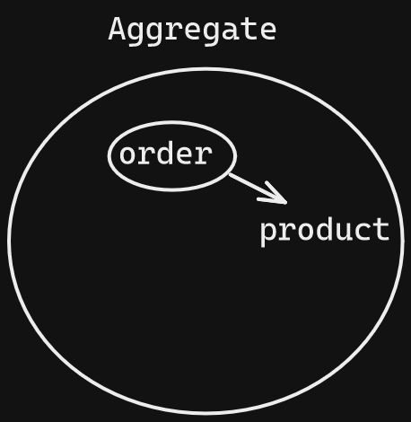

## Ubiquitous Language
- юзер
- товар
- каталог товаров - список товаров которые можно положить в корзину
- заказ - список товаров которые еще не забронированы и могут меняться
- доступные слоты доставки
- брони товаров на складе перед оплатой
- слот доставки - промежуток времени в который будет происходить доставка
  оформление заказа - переход заказа в состояние, в котором бронируются товары, происходит выбор доставки и способа оплаты
- уведомление
- оплата
- возврат средств
- ошибка

## Invariants

- Юзер может получить список товаров
- Юзер может добавить товар в корзину
    -  *Нельзя добавить товар в корзину, если его нет в наличии*
- Юзер может забронировать заказ
    - *Данные о количестве товаров в каталоге должны быть синхронизированы с каждым бронированием*
- Юзер может оформить доставку при бронировании заказа с возможностью уточнения времени доставки
    - *Каждый пользователь может выбрать только 1 доступный слот доставки*
- Юзер может удалить/добавить товар из уже финализируемого заказа, но после этого заказ будет заново забронирован
- Если юзер не оформил заказ через некоторое время, то ему через некоторое время придет уведомление о том что заказ не закончен
    - *порядок прихода уведомлений должен соответствовать порядку происхождения событий над заказом*
- Юзер должен оплатить заказ в течении определенного времени, иначе заказ будет аннулирован
- Если доставка не была выполнена вовремя или из-за ошибки во время бронирования, то производится возврат средств


## 1 Bounded Context

## Entities
```kotlin
class User(
   name: String,
   phoneNumber: String,
   email: String,
   address: List<Order>,
   orders: String) {
   private lateinit val id: UUID
}

class Product(
    val name: String, 
    val price: Float){
   private lateinit val id: UUID
}

class Delivery(
    val date: Date, 
    val address: String, 
    val weight: Float) {
    private lateinit val id: UUID
}


class Order(
    val products: List<Product>, 
    val orderStatus: OrderStatus,
    val payment: Payment,
    val deliveryTime: Date,
    val assemblingTime: Time) {
    private lateinit val id: UUID
}

class Payment(
    val paidDate: Date,
    val totalPrice: float,
    val status: PaymentStatus) {
    private lateinit val id: UUID
}
```

## Value objects:
```kotlin 
deliverySlot🐘 {
    time
    address
}
```


## Aggregates:


## Events

- Пользователь добавил новый товар в корзину
- Пользовать удалил товар из корзины
- Пользовал начал оплату
- Пользовать произвел оплату
- Оплата прошла успешно
- Бронирование прошло успешно
- Пользователь сформировал заказ
- Пользователь выбрал слот на доставку
- Заказ успешно сформирован
- В ходе работы с заказом произошла ошибка
- Пользователь отменил бронь
- Создан новый пользователь
- Пользователь бросил заказ (посылается уведомление для продолжения оформления заказа)
- Заказ отменен
- Заказ доставлен

## Commands
- Добавить товар в заказ
- Создать пользователя
- Удалить товар из заказа
- Забронировать заказ
- Отменить заказ
- Провести платеж
- Выбрать слот доставки
- Поменять статус заказа
- Уведомить пользователя о том что у него есть не оплаченный заказ